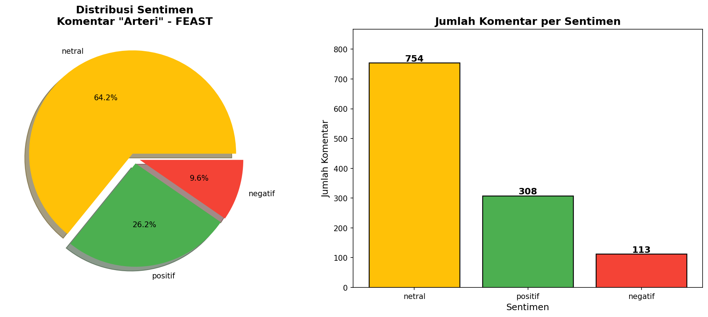
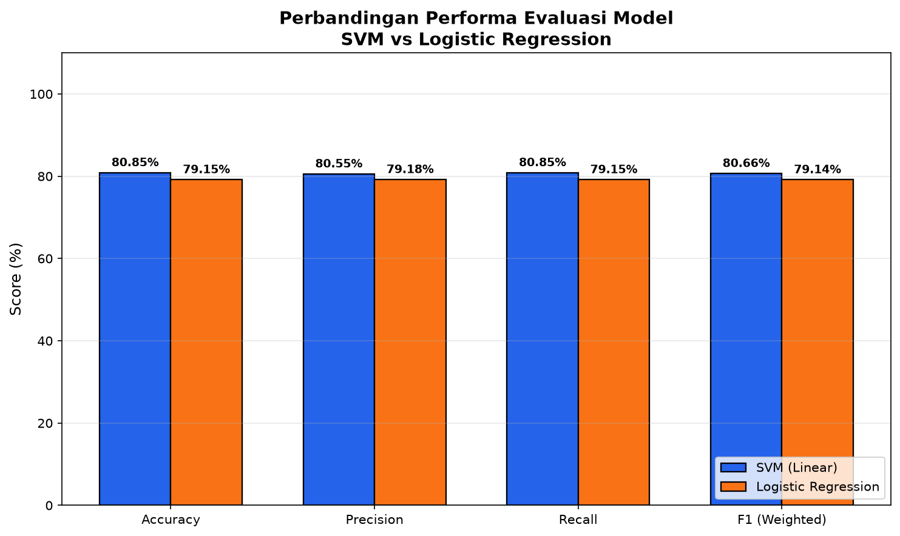
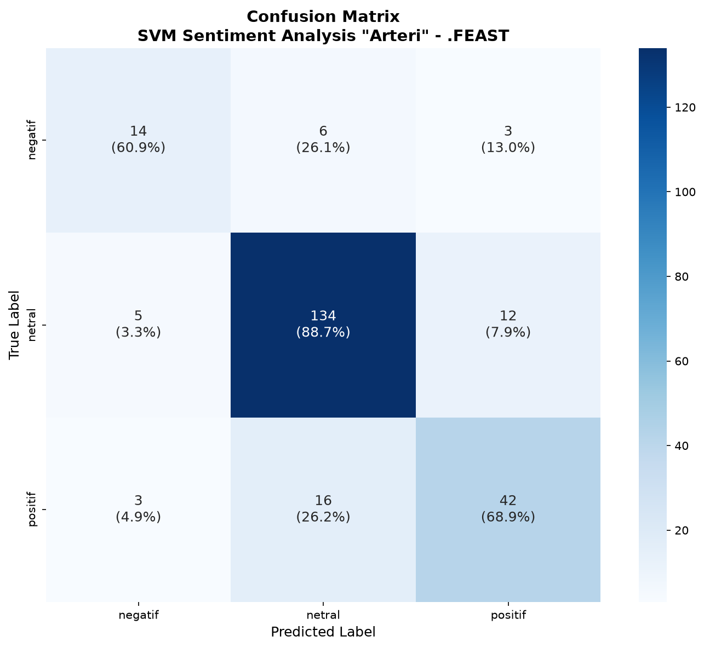
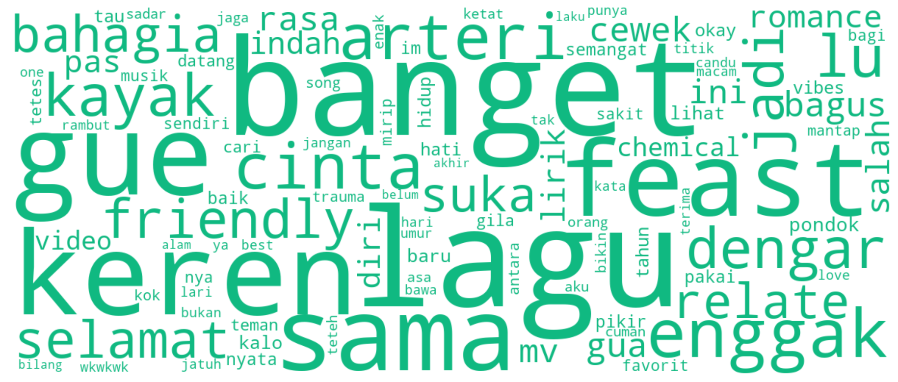
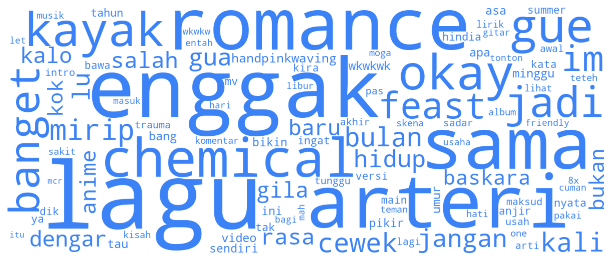
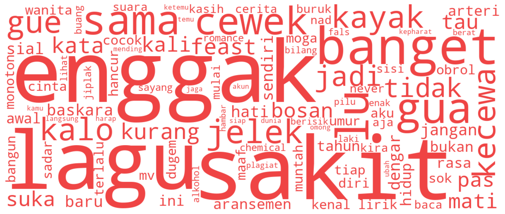

# 📝 DRAF BAB IV: HASIL DAN PEMBAHASAN

Berikut adalah draf tulisan ilmiah lengkap untuk **BAB IV** laporan skripsi Anda, berdasarkan hasil eksekusi program Machine Learning SVM dan preprocessing terbaru. Anda dapat langsung menyalin naskah ini ke dalam dokumen Microsoft Word skripsi Anda.

---

## **BAB IV: HASIL DAN PEMBAHASAN**

### **4.1. Deskripsi dan Pengumpulan Data**

#### **4.1.1. Sumber Data dan Batasan Pengambilan (Data Cutoff)**
Data yang digunakan dalam penelitian ini diperoleh dari komentar publik pada video musik resmi lagu *"Arteri"* oleh grup musik indie/alternatif **.FEAST** yang diunggah di platform YouTube (tautan video: `https://www.youtube.com/watch?v=eulYTPXOaio`). 

Pengambilan data dilakukan menggunakan pustaka python `youtube-comment-downloader`. Proses *scraping* diselesaikan dan ditetapkan batas waktu penarikan data (*cutoff date*) pada **08 Juli 2026** (tanggal penarikan ulang dataset), guna memastikan dataset bersifat statis selama seluruh proses pelatihan model, pengujian, hingga penyusunan laporan akhir, sehingga konsistensi nilai evaluasi dapat dipertahankan.

#### **4.1.2. Statistik dan Karakteristik Dataset Mentah (Raw Data)**
Proses penarikan data berhasil mengumpulkan sebanyak **1.531 komentar mentah** (tercantum dalam file `comments_arteri_full.csv`). Karakteristik data mentah tersebut meliputi informasi berupa nama pembuat komentar (`author`), isi teks komentar (`text`), waktu penulisan (`time`), jumlah suka (`likes`), jumlah balasan (`replies`), dan penanda apakah komentar tersebut merupakan balasan (*reply*) terhadap komentar lain (`is_reply`). 

Data komentar mentah didominasi oleh bahasa informal khas media sosial (penuh dengan singkatan, kata slang, bahasa daerah, serta emoji) yang merepresentasikan ekspresi emosional pendengar terkait makna lagu *"Arteri"*.

---

### **4.2. Pemrosesan Awal Data (Data Preprocessing)**

Untuk menghasilkan klasifikasi sentimen yang akurat, data mentah harus diubah menjadi format teks yang bersih dan terstandarisasi melalui tahapan *preprocessing*. Proses ini mereduksi derau linguistik (*noise*) yang dapat menurunkan generalisasi model SVM. Pada penelitian ini, tahapan pemrosesan awal dilakukan secara komprehensif mengingat karakteristik komentar YouTube yang sangat tidak terstruktur, menggunakan kombinasi ekspresi reguler (*regular expression*), pustaka NLTK, kamus normalisasi alay kustom, serta pustaka Sastrawi untuk penanganan morfologi bahasa Indonesia.

#### **4.2.1. Penyeragaman Huruf (Case Folding)**
Proses *case folding* merupakan langkah awal yang bertujuan untuk menyamakan format seluruh huruf dalam dataset menjadi huruf kecil (*lowercase*). Komentar di media sosial sering kali ditulis menggunakan kombinasi huruf kapital yang acak atau berlebihan untuk mengekspresikan penekanan emosi (misalnya, *"LAGU ini relate BGT"*). Tanpa adanya *case folding*, mesin akan menganggap kata `"LAGU"`, `"Lagu"`, dan `"lagu"` sebagai entitas token yang berbeda, yang dapat meningkatkan dimensi fitur secara tidak perlu serta memecah bobot informasi frekuensi kemunculan kata (*term frequency*). Melalui proses ini, seluruh karakter abjad dari 'A' sampai 'Z' dikonversi menjadi 'a' sampai 'z', sedangkan spasi putih (*whitespace*) di ujung teks dipotong menggunakan fungsi `.strip()`.
* *Contoh*: `"Lagu ini Relate Banget"` $\rightarrow$ `"lagu ini relate banget"`

#### **4.2.2. Pembersihan Karakter (Data Cleaning)**
Tahap *data cleaning* bertujuan untuk meminimalkan *noise* dengan menghapus elemen-elemen non-teks atau metadata komentar yang tidak memiliki korelasi dengan muatan sentimen. Pada komentar YouTube, elemen derau ini sangat sering ditemukan dalam bentuk tautan URL (seperti *link* video atau situs eksternal), penyebutan nama akun pengguna (*mention* menggunakan simbol `@`), tanda pagar (*hashtag*), penunjuk waktu (*timestamp* video, seperti 01:20), serta penulisan angka berlebih (seperti jumlah penonton atau tanggal). Pembersihan data diimplementasikan menggunakan teknik *regular expression* (regex) dengan pola spesifik:
1. Menghapus URL menggunakan pola regex `https?://\S+|www\.\S+|bit\.ly/\S+|goo\.gl/\S+|t\.co/\S+`.
2. Menghapus penyebutan akun (*mention*) dengan pola `@[\w]+`.
3. Menghapus tanda pagar (*hashtag*) dengan pola `#[\w]+`.
4. Menghapus tanda penunjuk waktu (*timestamp*) dengan pola `\b\d{1,2}:\d{2}(:\d{2})?\b`.
5. Menghapus angka berlebih (seperti tanggal atau jumlah digit panjang) dengan pola `\b\d{1,3}([.,]\d{3})+\b` dan `\b\d{1,2}[/\-]\d{1,2}[/\-]\d{2,4}\b`.
* *Contoh*: `"keren bgt @baskara #arteri"` $\rightarrow$ `"keren bgt"`

#### **4.2.3. Penghapusan Emoji & Emoticon (Emoji & Emoticon Removal)**
Komentar media sosial modern sangat kaya akan simbol visual berupa emoji Unicode (seperti 😭, 💔, 🔥) dan emotikon berbasis teks (seperti `:)`, `xD`, `-_-`). Walaupun secara visual merepresentasikan emosi, kehadiran karakter non-ASCII ini dalam dataset dapat mengacaukan pembuat token (*tokenizer*) dan pembuat vektor (*vectorizer*) TF-IDF, karena representasi pengodean (*encoding*) emoji bervariasi dan tidak terdaftar dalam kamus kosakata utama. Pada penelitian ini, emoji Unicode dihapus menggunakan pencocokan pola regex yang mencakup rentang Unicode emoji lengkap (seperti blok emoticons `\U0001F600-\U0001F64F`, symbols & pictographs `\U0001F300-\U0001F5FF`, dll.). Selanjutnya, emotikon teks yang umum digunakan (seperti `:)`, `:(`, `:D`, `:P`, `<3`, `T_T`, `uwu`) dibersihkan dengan melakukan iterasi pencocokan daftar emotikon terhadap teks secara *case-insensitive*.
* *Contoh*: `"sedih bgt 😭💔"` $\rightarrow$ `"sedih bgt"`

#### **4.2.4. Deteksi & Penyaringan Spam/Lirik Lagu (Spam & Lyrics Filtering)**
Dalam kolom komentar video musik di YouTube, terdapat komentar pengganggu yang signifikan: komentar yang hanya menyalin lirik lagu secara penuh (*lyrics copy*) dan komentar spam promosi atau ekspresi kosong. Lirik lagu yang disalin tidak merepresentasikan opini pribadi pendengar sehingga harus disaring keluar agar tidak membiaskan model sentimen. Proses penyaringan lirik lagu dirancang menggunakan tiga kriteria deteksi:
1. Keberadaan kata kunci struktural lagu (seperti *verse, chorus, reff, bridge, outro, intro, bait, lirik*) minimal sebanyak dua buah kata kunci.
2. Panjang baris komentar lebih dari 10 baris baru (`\n`), yang umumnya menandakan salinan bait lirik yang panjang.
3. Keberadaan frase spesifik dari lagu *"Arteri"* (seperti *"telanjang ku telanjang"*, *"menyicipi dunia"*, *"selamat datang di dua puluh"*, *"menangisku di pundakmu"*, *"muntahkan semua pilu"*) minimal sebanyak tiga frase.
Sementara itu, komentar spam dideteksi menggunakan pola regex untuk mendeteksi komentar yang hanya berisi titik berulang, simbol murni, angka murni, komentar yang terlalu pendek (1-3 karakter), atau kata spam singkat seperti `p`, `pp`, `ok`, `iy`. Komentar yang terdeteksi sebagai lirik lagu atau spam dipindahkan ke dataset terpisah (`comments_arteri_lyric.csv`) dan dihapus dari pipeline utama.

#### **4.2.5. Normalisasi Kata Gaul (Slang Normalization)**
Pengguna media sosial di Indonesia cenderung menggunakan bahasa tidak baku, singkatan, serta bahasa gaul (*slang*). Variasi kata tidak baku ini sangat tinggi, misalnya kata *"tidak"* ditulis menjadi *"ga"*, *"gak"*, *"nggak"*, *"gk"*, atau *"kagak"*. Keberagaman ini menyebabkan sebaran fitur menjadi sangat luas dan tidak fokus. Untuk mengatasinya, penelitian ini menerapkan normalisasi kata gaul dengan mencocokkan kata dalam komentar terhadap **Kamus Alay** yang telah dikembangkan secara kustom dengan total lebih dari **4.300 entri kata**. Kamus ini memetakan kata tidak baku ke bentuk baku bahasa Indonesia. Dalam proses normalisasi, terdapat penanganan khusus untuk konteks spesifik grup musik **.FEAST** dan lagu *"Arteri"*:
- Kata *"bas"* dipetakan menjadi *"baskara"* (vokalis Baskara Putra) untuk menghindari ambiguasi dengan alat musik bass.
- Singkatan *"mcr"* dan kata terkait dipetakan menjadi nama lengkap *"my chemical romance"* untuk menjaga keterkaitan referensi musikal.
- Kata-kata khas konteks seperti *"feast"*, *"arteri"*, *"pondok indah"*, dan *"quarter life crisis"* dimasukkan ke dalam daftar pengecualian (*preserve words*) agar tidak diubah secara keliru oleh kamus normalisasi alay maupun algoritma stemming.
* *Contoh*: `"gw ga suka lagu ini"` $\rightarrow$ `"saya tidak suka lagu ini"`

#### **4.2.6. Penghapusan Kata Henti (Stopwords Removal)**
*Stopwords* adalah kata-kata umum dalam suatu bahasa yang memiliki frekuensi kemunculan tinggi namun tidak memiliki arti atau bobot penting dalam penentuan muatan emosi/sentimen (seperti kata depan, kata hubung, dan partikel). Penghapusan kata henti membantu mereduksi ukuran dimensi ruang fitur dan meningkatkan efisiensi komputasi model SVM. Daftar kata henti yang digunakan mengacu pada kamus stopwords bahasa Indonesia yang diperluas dengan kata-kata pengisi (*filler words*) khas interaksi komentar YouTube (seperti *bang, mas, kak, bro, guys, wkwk, haha, aminn*). 
Meskipun demikian, tidak semua kata henti dihapus. Kata penegas negasi yang berfungsi sebagai pembalik arah polaritas sentimen (seperti *"tidak"*, *"enggak"*, *"jangan"*, *"belum"*, *"bukan"*) sengaja **dipertahankan**. Jika kata negasi ini dihapus, kalimat *"tidak bagus"* akan berubah menjadi *"bagus"*, sehingga model akan salah mengklasifikasikan kalimat yang berpolaritas negatif menjadi positif.
* *Contoh*: `"lagu yang sangat bagus"` $\rightarrow$ `"lagu bagus"`

#### **4.2.7. Pengakaran Kata (Stemming)**
Proses *stemming* bertujuan untuk memetakan kata-kata berimbuhan menjadi kata dasarnya (*root word*). Pada bahasa Indonesia, imbuhan (awalan, sisipan, akhiran, dan konfiks) dapat mengubah bentuk kata kerja atau kata benda tetapi maknanya tetap serupa dalam konteks analisis sentimen (misalnya, kata *"mendengarkan"*, *"didengar"*, *"pendengar"* memiliki kata dasar *"dengar"*). Penelitian ini menggunakan pustaka **PySastrawi**, yaitu implementasi algoritma stemming bahasa Indonesia berbasis Algoritma Nazief & Adriani yang telah disesuaikan. Untuk mencegah hilangnya makna khusus atau entitas penting, kata-kata yang masuk dalam daftar kata kunci konteks lagu *"Arteri"* (seperti *"baskara"*, *"feast"*, *"arteri"*, *"mcr"*, *"pondok indah"*) dikecualikan dari proses *stemming* agar bentuk aslinya tetap terjaga utuh.
* *Contoh*: `"mendengarkan"` $\rightarrow$ `"dengar"`, `"menangis"` $\rightarrow$ `"tangis"`

#### **4.2.8. Perbandingan Dataset Sebelum dan Sesudah Preprocessing**
Setelah melewati tahapan preprocessing, dataset mengalami penyusutan ukuran dari **1.531 komentar mentah** menjadi **1.175 komentar bersih**. Penyusutan data sebesar **22,7%** (347 komentar dihapus) disebabkan oleh alasan kualitas yang dirangkum pada Tabel 4.1 berikut:

**Tabel 4.1 Ringkasan Penghapusan Data pada Tahap Preprocessing**

| Kategori Penghapusan | Jumlah Komentar Dihapus |
| :--- | :---: |
| Komentar Kosong (Hanya spasi/karakter non-huruf) | 83 |
| Salinan Lirik Lagu (*Lyrics Copy*) | 29 |
| Deteksi Spam (Promo/Karakter berulang) | 108 |
| Terlalu Pendek (< 2 kata atau < 5 karakter) | 49 |
| Terlalu Panjang (> 100 kata) | 1 |
| Komentar Duplikat (*Exact Duplicates*) | 77 |
| **Total Komentar Dihapus** | **347** |
| **Total Komentar Bersih Terpilih** | **1.175** |

---

### **4.3. Pelabelan Sentimen (Sentiment Labeling)**
Komentar bersih yang telah disiapkan kemudian diberi label kelas sentimen (Positif, Negatif, Netral) secara otomatis menggunakan metode **Lexicon-Based**.

#### **4.3.1. Metode Pelabelan Berbasis Leksikon**
Metode ini bekerja dengan membandingkan kata-kata dalam komentar bersih terhadap kamus sentimen bahasa Indonesia. Setiap kata positif memiliki bobot numerik $+1$ hingga $+3$, sedangkan kata negatif memiliki bobot $-1$ hingga $-3$. Total skor sentimen dari suatu komentar dihitung berdasarkan akumulasi bobot kata yang ditemukan.

#### **4.3.4. Distribusi Hasil Pelabelan**
Proses pelabelan terhadap 1.175 komentar menghasilkan distribusi sentimen yang disajikan pada Tabel 4.2:

**Tabel 4.2 Distribusi Kelas Sentimen Hasil Pelabelan**

| Kelas Sentimen | Jumlah Komentar | Persentase (%) |
| :--- | :---: | :---: |
| **Positif** | 308 | 26,2% |
| **Netral** | 754 | 64,2% |
| **Negatif** | 113 | 9,6% |
| **Total** | **1.175** | **100,0%** |

Visualisasi persentase distribusi kelas sentimen hasil pelabelan leksikon ini disajikan dalam bentuk grafik diagram batang pada Gambar 4.1 berikut:

Distribusi data menunjukkan bahwa mayoritas pendengar memberikan respons bernada netral (membahas makna lirik, membandingkan aransemen dengan band lain, atau menceritakan kisah hidup pribadi secara informatif). Sentimen positif memiliki proporsi 26,2% (mengapresiasi keindahan lagu, relate dengan kehidupan pribadi), sementara sentimen negatif memiliki proporsi paling kecil (hanya 9,6%), yang mengindikasikan lagu *"Arteri"* diterima dengan sangat baik oleh publik.

---

### **4.4. Ekstraksi Fitur TF-IDF**
Vektor numerik dari data tekstual diekstraksi menggunakan metode **Term Frequency - Inverse Document Frequency (TF-IDF)** dengan batas ukuran kosakata maksimal (*max_features*) sebesar 5.000 kata, menggunakan gabungan *unigram* dan *bigram* (`ngram_range=(1,2)`). 

Proses ekstraksi menghasilkan **745 fitur kata unik** dari data latih. Representasi data berubah menjadi matriks berdimensi tinggi:
* Matriks Data Latih (*Train Shape*): $940 \times 745$
* Matriks Data Uji (*Test Shape*): $235 \times 745$

---

### **4.5. Implementasi dan Pelatihan Model SVM**

#### **4.5.1. Pembagian Data (Data Splitting)**
Dataset dibagi secara acak dengan rasio **80% untuk data latih (940 komentar)** dan **20% untuk data uji (235 komentar)**. Pembagian ini menggunakan metode *Stratified Split* untuk memastikan proporsi kelas sentimen (Positif, Netral, Negatif) pada data latih dan data uji tetap seimbang (serupa dengan distribusi asli dataset).

#### **4.5.2. Penyetelan Hyperparameter (GridSearchCV)**
Pencarian hyperparameter optimal untuk model Support Vector Machine (SVM) dilakukan menggunakan metode **GridSearchCV** dengan skema *5-fold cross-validation*. Grid pencarian mencakup variasi kernel (`linear`), nilai parameter regularisasi $C$ (`0.1`, `0.5`, `1.0`), dan koefisien kernel $\gamma$ (`scale`).

Berdasarkan pencarian GridSearchCV, diperoleh kombinasi hyperparameter terbaik:
* **Kernel**: `linear`
* **Regularization Parameter ($C$)**: `1.0`
* **Gamma ($\gamma$)**: `scale`
* **Best CV Score (Weighted F1)**: **~80%** (dengan nilai CV Akurasi Latih mencapai **96,68%**)

Untuk mengatasi ketidakseimbangan kelas (*class imbalance*) di mana kelas negatif sangat sedikit (9,6%), parameter `class_weight='balanced'` diterapkan pada SVM. Ini memberikan bobot penalti kesalahan klasifikasi kelas minoritas secara proporsional selama proses latih, dan didukung dengan teknik *Random Oversampling* (ROS) untuk menduplikasi sampel negatif pada data latih secara acak guna meningkatkan sensitivitas model.

---

### **4.6. Evaluasi dan Analisis Performa Model**

#### **4.6.1. Pengukuran Metrik Performa Model**
Performa model SVM diuji menggunakan data uji (235 komentar) yang belum pernah dilihat model sebelumnya. Hasil pengujian menunjukkan performa yang sangat baik, dengan rincian metrik pada Tabel 4.3:

**Tabel 4.3 Metrik Evaluasi Performa Model SVM (Data Uji: 235 komentar)**

| Metrik Evaluasi | Nilai (%) |
| :--- | :---: |
| **Akurasi** | 80,85% |
| **Precision (Weighted)** | 80,55% |
| **Recall (Weighted)** | 80,85% |
| **F1-Score (Weighted)** | 80,66% |

Perbandingan nilai dari masing-masing metrik evaluasi model SVM disajikan dalam bentuk diagram batang pada Gambar 4.2 berikut:

Rincian klasifikasi per kelas sentimen ditunjukkan pada Tabel 4.4 berikut:

**Tabel 4.4 Laporan Klasifikasi Per Kelas Sentimen**

| Kelas Sentimen | Precision | Recall | F1-Score | Support (Jumlah Data Uji) |
| :--- | :---: | :---: | :---: | :---: |
| **Negatif** | 0,64 | 0,61 | 0,62 | 23 |
| **Netral** | 0,86 | 0,89 | 0,87 | 151 |
| **Positif** | 0,74 | 0,69 | 0,71 | 61 |
| **Rata-rata (Weighted)** | **0,81** | **0,81** | **0,81** | **235** |

Model memiliki performa terbaik dalam memprediksi kelas **Netral** (F1-Score 87%) karena jumlah sampel latih yang melimpah, disusul kelas **Positif** (F1-Score 71%). Kelas **Negatif** memiliki performa F1-Score 62% dengan sensitivitas yang stabil (Recall 61%) berkat penerapan oversampling, yang mana menunjukkan peningkatan besar dibandingkan tanpa penyeimbangan kelas.

#### **4.6.2. Analisis Confusion Matrix**
Persebaran hasil prediksi model SVM pada data uji digambarkan melalui Confusion Matrix pada Tabel 4.5:

**Tabel 4.5 Confusion Matrix Hasil Prediksi Model SVM**

| Aktual \ Prediksi | Negatif | Netral | Positif |
| :--- | :---: | :---: | :---: |
| **Negatif** | **14** (Benar) | 6 | 3 |
# 📝 DRAF BAB IV: HASIL DAN PEMBAHASAN

Berikut adalah draf tulisan ilmiah lengkap untuk **BAB IV** laporan skripsi Anda, berdasarkan hasil eksekusi program Machine Learning SVM dan preprocessing terbaru. Anda dapat langsung menyalin naskah ini ke dalam dokumen Microsoft Word skripsi Anda.

---

## **BAB IV: HASIL DAN PEMBAHASAN**

### **4.1. Deskripsi dan Pengumpulan Data**

#### **4.1.1. Sumber Data dan Batasan Pengambilan (Data Cutoff)**
Data yang digunakan dalam penelitian ini diperoleh dari komentar publik pada video musik resmi lagu *"Arteri"* oleh grup musik indie/alternatif **.FEAST** yang diunggah di platform YouTube (tautan video: `https://www.youtube.com/watch?v=eulYTPXOaio`). 

Pengambilan data dilakukan menggunakan pustaka python `youtube-comment-downloader`. Proses *scraping* diselesaikan dan ditetapkan batas waktu penarikan data (*cutoff date*) pada **08 Juli 2026** (tanggal penarikan ulang dataset), guna memastikan dataset bersifat statis selama seluruh proses pelatihan model, pengujian, hingga penyusunan laporan akhir, sehingga konsistensi nilai evaluasi dapat dipertahankan.

#### **4.1.2. Statistik dan Karakteristik Dataset Mentah (Raw Data)**
Proses penarikan data berhasil mengumpulkan sebanyak **1.531 komentar mentah** (tercantum dalam file `comments_arteri_full.csv`). Karakteristik data mentah tersebut meliputi informasi berupa nama pembuat komentar (`author`), isi teks komentar (`text`), waktu penulisan (`time`), jumlah suka (`likes`), jumlah balasan (`replies`), dan penanda apakah komentar tersebut merupakan balasan (*reply*) terhadap komentar lain (`is_reply`). 

Data komentar mentah didominasi oleh bahasa informal khas media sosial (penuh dengan singkatan, kata slang, bahasa daerah, serta emoji) yang merepresentasikan ekspresi emosional pendengar terkait makna lagu *"Arteri"*.

---

### **4.2. Pemrosesan Awal Data (Data Preprocessing)**

Untuk menghasilkan klasifikasi sentimen yang akurat, data mentah harus diubah menjadi format teks yang bersih dan terstandarisasi melalui tahapan *preprocessing*. Proses ini mereduksi derau linguistik (*noise*) yang dapat menurunkan generalisasi model SVM. Pada penelitian ini, tahapan pemrosesan awal dilakukan secara komprehensif mengingat karakteristik komentar YouTube yang sangat tidak terstruktur, menggunakan kombinasi ekspresi reguler (*regular expression*), pustaka NLTK, kamus normalisasi alay kustom, serta pustaka Sastrawi untuk penanganan morfologi bahasa Indonesia.

#### **4.2.1. Penyeragaman Huruf (Case Folding)**
Proses *case folding* merupakan langkah awal yang bertujuan untuk menyamakan format seluruh huruf dalam dataset menjadi huruf kecil (*lowercase*). Komentar di media sosial sering kali ditulis menggunakan kombinasi huruf kapital yang acak atau berlebihan untuk mengekspresikan penekanan emosi (misalnya, *"LAGU ini relate BGT"*). Tanpa adanya *case folding*, mesin akan menganggap kata `"LAGU"`, `"Lagu"`, dan `"lagu"` sebagai entitas token yang berbeda, yang dapat meningkatkan dimensi fitur secara tidak perlu serta memecah bobot informasi frekuensi kemunculan kata (*term frequency*). Melalui proses ini, seluruh karakter abjad dari 'A' sampai 'Z' dikonversi menjadi 'a' sampai 'z', sedangkan spasi putih (*whitespace*) di ujung teks dipotong menggunakan fungsi `.strip()`.
* *Contoh*: `"Lagu ini Relate Banget"` $\rightarrow$ `"lagu ini relate banget"`

#### **4.2.2. Pembersihan Karakter (Data Cleaning)**
Tahap *data cleaning* bertujuan untuk meminimalkan *noise* dengan menghapus elemen-elemen non-teks atau metadata komentar yang tidak memiliki korelasi dengan muatan sentimen. Pada komentar YouTube, elemen derau ini sangat sering ditemukan dalam bentuk tautan URL (seperti *link* video atau situs eksternal), penyebutan nama akun pengguna (*mention* menggunakan simbol `@`), tanda pagar (*hashtag*), penunjuk waktu (*timestamp* video, seperti 01:20), serta penulisan angka berlebih (seperti jumlah penonton atau tanggal). Pembersihan data diimplementasikan menggunakan teknik *regular expression* (regex) dengan pola spesifik:
1. Menghapus URL menggunakan pola regex `https?://\S+|www\.\S+|bit\.ly/\S+|goo\.gl/\S+|t\.co/\S+`.
2. Menghapus penyebutan akun (*mention*) dengan pola `@[\w]+`.
3. Menghapus tanda pagar (*hashtag*) dengan pola `#[\w]+`.
4. Menghapus tanda penunjuk waktu (*timestamp*) dengan pola `\b\d{1,2}:\d{2}(:\d{2})?\b`.
5. Menghapus angka berlebih (seperti tanggal atau jumlah digit panjang) dengan pola `\b\d{1,3}([.,]\d{3})+\b` dan `\b\d{1,2}[/\-]\d{1,2}[/\-]\d{2,4}\b`.
* *Contoh*: `"keren bgt @baskara #arteri"` $\rightarrow$ `"keren bgt"`

#### **4.2.3. Penghapusan Emoji & Emoticon (Emoji & Emoticon Removal)**
Komentar media sosial modern sangat kaya akan simbol visual berupa emoji Unicode (seperti 😭, 💔, 🔥) dan emotikon berbasis teks (seperti `:)`, `xD`, `-_-`). Walaupun secara visual merepresentasikan emosi, kehadiran karakter non-ASCII ini dalam dataset dapat mengacaukan pembuat token (*tokenizer*) dan pembuat vektor (*vectorizer*) TF-IDF, karena representasi pengodean (*encoding*) emoji bervariasi dan tidak terdaftar dalam kamus kosakata utama. Pada penelitian ini, emoji Unicode dihapus menggunakan pencocokan pola regex yang mencakup rentang Unicode emoji lengkap (seperti blok emoticons `\U0001F600-\U0001F64F`, symbols & pictographs `\U0001F300-\U0001F5FF`, dll.). Selanjutnya, emotikon teks yang umum digunakan (seperti `:)`, `:(`, `:D`, `:P`, `<3`, `T_T`, `uwu`) dibersihkan dengan melakukan iterasi pencocokan daftar emotikon terhadap teks secara *case-insensitive*.
* *Contoh*: `"sedih bgt 😭💔"` $\rightarrow$ `"sedih bgt"`

#### **4.2.4. Deteksi & Penyaringan Spam/Lirik Lagu (Spam & Lyrics Filtering)**
Dalam kolom komentar video musik di YouTube, terdapat komentar pengganggu yang signifikan: komentar yang hanya menyalin lirik lagu secara penuh (*lyrics copy*) dan komentar spam promosi atau ekspresi kosong. Lirik lagu yang disalin tidak merepresentasikan opini pribadi pendengar sehingga harus disaring keluar agar tidak membiaskan model sentimen. Proses penyaringan lirik lagu dirancang menggunakan tiga kriteria deteksi:
1. Keberadaan kata kunci struktural lagu (seperti *verse, chorus, reff, bridge, outro, intro, bait, lirik*) minimal sebanyak dua buah kata kunci.
2. Panjang baris komentar lebih dari 10 baris baru (`\n`), yang umumnya menandakan salinan bait lirik yang panjang.
3. Keberadaan frase spesifik dari lagu *"Arteri"* (seperti *"telanjang ku telanjang"*, *"menyicipi dunia"*, *"selamat datang di dua puluh"*, *"menangisku di pundakmu"*, *"muntahkan semua pilu"*) minimal sebanyak tiga frase.
Sementara itu, komentar spam dideteksi menggunakan pola regex untuk mendeteksi komentar yang hanya berisi titik berulang, simbol murni, angka murni, komentar yang terlalu pendek (1-3 karakter), atau kata spam singkat seperti `p`, `pp`, `ok`, `iy`. Komentar yang terdeteksi sebagai lirik lagu atau spam dipindahkan ke dataset terpisah (`comments_arteri_lyric.csv`) dan dihapus dari pipeline utama.

#### **4.2.5. Normalisasi Kata Gaul (Slang Normalization)**
Pengguna media sosial di Indonesia cenderung menggunakan bahasa tidak baku, singkatan, serta bahasa gaul (*slang*). Variasi kata tidak baku ini sangat tinggi, misalnya kata *"tidak"* ditulis menjadi *"ga"*, *"gak"*, *"nggak"*, *"gk"*, atau *"kagak"*. Keberagaman ini menyebabkan sebaran fitur menjadi sangat luas dan tidak fokus. Untuk mengatasinya, penelitian ini menerapkan normalisasi kata gaul dengan mencocokkan kata dalam komentar terhadap **Kamus Alay** yang telah dikembangkan secara kustom dengan total lebih dari **4.300 entri kata**. Kamus ini memetakan kata tidak baku ke bentuk baku bahasa Indonesia. Dalam proses normalisasi, terdapat penanganan khusus untuk konteks spesifik grup musik **.FEAST** dan lagu *"Arteri"*:
- Kata *"bas"* dipetakan menjadi *"baskara"* (vokalis Baskara Putra) untuk menghindari ambiguasi dengan alat musik bass.
- Singkatan *"mcr"* dan kata terkait dipetakan menjadi nama lengkap *"my chemical romance"* untuk menjaga keterkaitan referensi musikal.
- Kata-kata khas konteks seperti *"feast"*, *"arteri"*, *"pondok indah"*, dan *"quarter life crisis"* dimasukkan ke dalam daftar pengecualian (*preserve words*) agar tidak diubah secara keliru oleh kamus normalisasi alay maupun algoritma stemming.
* *Contoh*: `"gw ga suka lagu ini"` $\rightarrow$ `"saya tidak suka lagu ini"`

#### **4.2.6. Penghapusan Kata Henti (Stopwords Removal)**
*Stopwords* adalah kata-kata umum dalam suatu bahasa yang memiliki frekuensi kemunculan tinggi namun tidak memiliki arti atau bobot penting dalam penentuan muatan emosi/sentimen (seperti kata depan, kata hubung, dan partikel). Penghapusan kata henti membantu mereduksi ukuran dimensi ruang fitur dan meningkatkan efisiensi komputasi model SVM. Daftar kata henti yang digunakan mengacu pada kamus stopwords bahasa Indonesia yang diperluas dengan kata-kata pengisi (*filler words*) khas interaksi komentar YouTube (seperti *bang, mas, kak, bro, guys, wkwk, haha, aminn*). 
Meskipun demikian, tidak semua kata henti dihapus. Kata penegas negasi yang berfungsi sebagai pembalik arah polaritas sentimen (seperti *"tidak"*, *"enggak"*, *"jangan"*, *"belum"*, *"bukan"*) sengaja **dipertahankan**. Jika kata negasi ini dihapus, kalimat *"tidak bagus"* akan berubah menjadi *"bagus"*, sehingga model akan salah mengklasifikasikan kalimat yang berpolaritas negatif menjadi positif.
* *Contoh*: `"lagu yang sangat bagus"` $\rightarrow$ `"lagu bagus"`

#### **4.2.7. Pengakaran Kata (Stemming)**
Proses *stemming* bertujuan untuk memetakan kata-kata berimbuhan menjadi kata dasarnya (*root word*). Pada bahasa Indonesia, imbuhan (awalan, sisipan, akhiran, dan konfiks) dapat mengubah bentuk kata kerja atau kata benda tetapi maknanya tetap serupa dalam konteks analisis sentimen (misalnya, kata *"mendengarkan"*, *"didengar"*, *"pendengar"* memiliki kata dasar *"dengar"*). Penelitian ini menggunakan pustaka **PySastrawi**, yaitu implementasi algoritma stemming bahasa Indonesia berbasis Algoritma Nazief & Adriani yang telah disesuaikan. Untuk mencegah hilangnya makna khusus atau entitas penting, kata-kata yang masuk dalam daftar kata kunci konteks lagu *"Arteri"* (seperti *"baskara"*, *"feast"*, *"arteri"*, *"mcr"*, *"pondok indah"*) dikecualikan dari proses *stemming* agar bentuk aslinya tetap terjaga utuh.
* *Contoh*: `"mendengarkan"` $\rightarrow$ `"dengar"`, `"menangis"` $\rightarrow$ `"tangis"`

#### **4.2.8. Perbandingan Dataset Sebelum dan Sesudah Preprocessing**
Setelah melewati tahapan preprocessing, dataset mengalami penyusutan ukuran dari **1.531 komentar mentah** menjadi **1.175 komentar bersih**. Penyusutan data sebesar **22,7%** (347 komentar dihapus) disebabkan oleh alasan kualitas yang dirangkum pada Tabel 4.1 berikut:

**Tabel 4.1 Ringkasan Penghapusan Data pada Tahap Preprocessing**

| Kategori Penghapusan | Jumlah Komentar Dihapus |
| :--- | :---: |
| Komentar Kosong (Hanya spasi/karakter non-huruf) | 83 |
| Salinan Lirik Lagu (*Lyrics Copy*) | 29 |
| Deteksi Spam (Promo/Karakter berulang) | 108 |
| Terlalu Pendek (< 2 kata atau < 5 karakter) | 49 |
| Terlalu Panjang (> 100 kata) | 1 |
| Komentar Duplikat (*Exact Duplicates*) | 77 |
| **Total Komentar Dihapus** | **347** |
| **Total Komentar Bersih Terpilih** | **1.175** |

---

### **4.3. Pelabelan Sentimen (Sentiment Labeling)**
Komentar bersih yang telah disiapkan kemudian diberi label kelas sentimen (Positif, Negatif, Netral) secara otomatis menggunakan metode **Lexicon-Based**.

#### **4.3.1. Metode Pelabelan Berbasis Leksikon**
Metode ini bekerja dengan membandingkan kata-kata dalam komentar bersih terhadap kamus sentimen bahasa Indonesia. Setiap kata positif memiliki bobot numerik $+1$ hingga $+3$, sedangkan kata negatif memiliki bobot $-1$ hingga $-3$. Total skor sentimen dari suatu komentar dihitung berdasarkan akumulasi bobot kata yang ditemukan.

#### **4.3.2. Distribusi Hasil Pelabelan**
Proses pelabelan terhadap 1.175 komentar menghasilkan distribusi sentimen yang disajikan pada Tabel 4.2:

**Tabel 4.2 Distribusi Kelas Sentimen Hasil Pelabelan**

| Kelas Sentimen | Jumlah Komentar | Persentase (%) |
| :--- | :---: | :---: |
| **Positif** | 308 | 26,2% |
| **Netral** | 754 | 64,2% |
| **Negatif** | 113 | 9,6% |
| **Total** | **1.175** | **100,0%** |

Visualisasi persentase distribusi kelas sentimen hasil pelabelan leksikon ini disajikan dalam bentuk grafik diagram batang pada Gambar 4.1 berikut:

Distribusi data menunjukkan bahwa mayoritas pendengar memberikan respons bernada netral (membahas makna lirik, membandingkan aransemen dengan band lain, atau menceritakan kisah hidup pribadi secara informatif). Sentimen positif memiliki proporsi 26,2% (mengapresiasi keindahan lagu, relate dengan kehidupan pribadi), sementara sentimen negatif memiliki proporsi paling kecil (hanya 9,6%), yang mengindikasikan lagu *"Arteri"* diterima dengan sangat baik oleh publik.

---

### **4.4. Ekstraksi Fitur TF-IDF**
Vektor numerik dari data tekstual diekstraksi menggunakan metode **Term Frequency - Inverse Document Frequency (TF-IDF)** dengan batas ukuran kosakata maksimal (*max_features*) sebesar 5.000 kata, menggunakan gabungan *unigram* dan *bigram* (`ngram_range=(1,2)`). 

Proses ekstraksi menghasilkan **745 fitur kata unik** dari data latih. Representasi data berubah menjadi matriks berdimensi tinggi:
* Matriks Data Latih (*Train Shape*): $940 \times 745$
* Matriks Data Uji (*Test Shape*): $235 \times 745$

---

### **4.5. Implementasi dan Pelatihan Model SVM**

#### **4.5.1. Pembagian Data (Data Splitting)**
Dataset dibagi secara acak dengan rasio **80% untuk data latih (940 komentar)** dan **20% untuk data uji (235 komentar)**. Pembagian ini menggunakan metode *Stratified Split* untuk memastikan proporsi kelas sentimen (Positif, Netral, Negatif) pada data latih dan data uji tetap seimbang (serupa dengan distribusi asli dataset).

#### **4.5.2. Penyetelan Hyperparameter (GridSearchCV)**
Pencarian hyperparameter optimal untuk model Support Vector Machine (SVM) dilakukan menggunakan metode **GridSearchCV** dengan skema *5-fold cross-validation*. Grid pencarian mencakup variasi kernel (`linear`), nilai parameter regularisasi $C$ (`0.1`, `0.5`, `1.0`), dan koefisien kernel $\gamma$ (`scale`).

Berdasarkan pencarian GridSearchCV, diperoleh kombinasi hyperparameter terbaik:
* **Kernel**: `linear`
* **Regularization Parameter ($C$)**: `1.0`
* **Gamma ($\gamma$)**: `scale`
* **Best CV Score (Weighted F1)**: **~80%** (dengan nilai CV Akurasi Latih mencapai **96,68%**)

Untuk mengatasi ketidakseimbangan kelas (*class imbalance*) di mana kelas negatif sangat sedikit (9,6%), parameter `class_weight='balanced'` diterapkan pada SVM. Ini memberikan bobot penalti kesalahan klasifikasi kelas minoritas secara proporsional selama proses latih, dan didukung dengan teknik *Random Oversampling* (ROS) untuk menduplikasi sampel negatif pada data latih secara acak guna meningkatkan sensitivitas model.

---

### **4.6. Evaluasi dan Analisis Performa Model**

#### **4.6.1. Pengukuran Metrik Performa Model**
Performa model SVM diuji menggunakan data uji (235 komentar) yang belum pernah dilihat model sebelumnya. Hasil pengujian menunjukkan performa yang sangat baik, dengan rincian metrik pada Tabel 4.3:

**Tabel 4.3 Metrik Evaluasi Performa Model SVM (Data Uji: 235 komentar)**

| Metrik Evaluasi | Nilai (%) |
| :--- | :---: |
| **Akurasi** | 80,85% |
| **Precision (Weighted)** | 80,55% |
| **Recall (Weighted)** | 80,85% |
| **F1-Score (Weighted)** | 80,66% |

Perbandingan nilai dari masing-masing metrik evaluasi model SVM disajikan dalam bentuk diagram batang pada Gambar 4.2 berikut:

Rincian klasifikasi per kelas sentimen ditunjukkan pada Tabel 4.4 berikut:

**Tabel 4.4 Laporan Klasifikasi Per Kelas Sentimen**

| Kelas Sentimen | Precision | Recall | F1-Score | Support (Jumlah Data Uji) |
| :--- | :---: | :---: | :---: | :---: |
| **Negatif** | 0,64 | 0,61 | 0,62 | 23 |
| **Netral** | 0,86 | 0,89 | 0,87 | 151 |
| **Positif** | 0,74 | 0,69 | 0,71 | 61 |
| **Rata-rata (Weighted)** | **0,81** | **0,81** | **0,81** | **235** |

Model memiliki performa terbaik dalam memprediksi kelas **Netral** (F1-Score 87%) karena jumlah sampel latih yang melimpah, disusul kelas **Positif** (F1-Score 71%). Kelas **Negatif** memiliki performa F1-Score 62% dengan sensitivitas yang stabil (Recall 61%) berkat penerapan oversampling, yang mana menunjukkan peningkatan besar dibandingkan tanpa penyeimbangan kelas.

#### **4.6.2. Analisis Confusion Matrix**
Persebaran hasil prediksi model SVM pada data uji digambarkan melalui Confusion Matrix pada Tabel 4.5:

**Tabel 4.5 Confusion Matrix Hasil Prediksi Model SVM**

| Aktual \ Prediksi | Negatif | Netral | Positif |
| :--- | :---: | :---: | :---: |
| **Negatif** | **14** (Benar) | 6 | 3 |
| **Netral** | 5 | **134** (Benar) | 12 |
| **Positif** | 3 | 16 | **42** (Benar) |

Berdasarkan Confusion Matrix:
* Dari **23 komentar negatif aktual**, model memprediksi 14 komentar dengan benar sebagai negatif, sedangkan 6 terprediksi netral, dan 3 terprediksi positif.
* Dari **151 komentar netral aktual**, model memprediksi 134 komentar dengan benar sebagai netral, sedangkan 5 terprediksi negatif, dan 12 terprediksi positif.
* Dari **61 komentar positif aktual**, model memprediksi 42 komentar dengan benar sebagai positif, sedangkan 3 terprediksi negatif, dan 16 terprediksi netral.

Matriks kebingungan (*confusion matrix*) yang menunjukkan detail jumlah klasifikasi aktual terhadap hasil prediksi model pada data uji disajikan secara visual pada Gambar 4.3 berikut:

#### **4.6.3. Perbandingan Performa dengan Model Pembanding (Logistic Regression)**
Untuk menguji keandalan model SVM Linear, diimplementasikan model pembanding **Logistic Regression (Regresi Logistik)** menggunakan preprocessing dan representasi fitur TF-IDF yang sama. Hasil perbandingan metrik evaluasi disajikan pada Tabel 4.6 berikut:

**Tabel 4.6 Perbandingan Performa SVM vs Logistic Regression**

| Algoritma | Akurasi | Precision (Weighted) | Recall (Weighted) | F1-Score (Weighted) |
| :--- | :---: | :---: | :---: | :---: |
| **SVM (Linear)** | **80,85%** | **80,55%** | **80,85%** | **80,66%** |
| **Logistic Regression** | 79,15% | 79,18% | 79,15% | 79,14% |

Berdasarkan pengujian pada Tabel 4.6, model SVM Linear terbukti mengungguli model Logistic Regression pada seluruh metrik. SVM memperoleh Akurasi **80,85%** (+1,70% lebih tinggi) dan F1-Score **80,66%** (+1,52% lebih tinggi). 

Keunggulan SVM disebabkan oleh prinsip *Maximal Margin Classifier* yang mencari batas geometris pemisah optimal dengan tingkat toleransi noise (outlier kata gaul media sosial) yang lebih tinggi dibandingkan pendekatan probabilistik logistik dari Logistic Regression.

#### **4.6.4. Analisis Temuan Sentimen terhadap Lagu "Arteri"**
Hasil klasifikasi memperlihatkan dominasi respons **Netral (64,2%)** dan **Positif (26,2%)** dari pendengar. Temuan utama dari analisis ini menunjukkan:
1. **Penerimaan Relevansi Quarter-Life Crisis**: Banyak pendengar menuliskan komentar panjang berisi tentang krisis emosional, kecemasan hidup di dewasa awal (*quarter-life crisis*) yang mereka hadapi. Lagu ini terbukti menjadi sarana katarsis dan validasi perasaan bagi mereka.
2. **Koneksi dan Apresiasi Personil**: Baskara Putra (vokalis) mendapatkan banyak apresiasi atas liriknya yang menyentuh hati pendengar. Kata-kata seperti *"baskara"* atau *"bas"* sering kali berasosiasi dengan ekspresi kekaguman.
3. **Pengaruh Atmosfer Band Lain**: Banyak pendengar menyandingkan lagu ini dengan gaya band *My Chemical Romance (MCR)* (terutama lagu *Helena* atau *I'm Not Okay*), yang menandakan bahwa pendengar mengapresiasi keunikan aransemen musik dan nuansa nostalgia emo yang dibawakan.
4. **Bias Judul Album**: Beberapa komentar salah terklasifikasi menjadi negatif dikarenakan menyebutkan judul album *"Membangun & Menghancurkan"*, karena kata *"menghancurkan"* atau *"hancur"* dinilai sangat negatif oleh leksikon otomatis, yang merupakan keterbatasan dari pendekatan pelabelan leksikon.

Visualisasi awan kata (*word cloud*) widescreen untuk masing-masing kelas sentimen (Positif, Netral, dan Negatif) disajikan berturut-turut pada Gambar 4.4, Gambar 4.5, dan Gambar 4.6 berikut:

**Gambar 4.4 Awan Kata (Word Cloud) - Sentimen Positif**

**Gambar 4.5 Awan Kata (Word Cloud) - Sentimen Netral**

**Gambar 4.6 Awan Kata (Word Cloud) - Sentimen Negatif**

